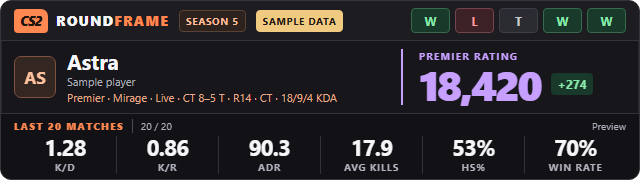

# Roundframe for CS2

 

A clean, compact CS2 Premier profile overlay for OBS on Windows 10 and 11. Roundframe combines your Premier Rating and recent match stats with live match details in a 640 × 180 browser source. Steam and CS2 are needed for live match data. The preview uses fictional data.

## Get started

1. Install [Python 3.10 or newer](https://www.python.org/downloads/windows/) and [OBS Studio](https://obsproject.com/download). Enable the Python launcher or add Python to PATH.
2. Download the latest **Windows ZIP** from [GitHub Releases](https://github.com/abhiraj109/cs2-roundframe/releases/latest) and extract it to a permanent folder.
3. Run `setup_once.bat` to install the CS2 Game State Integration (GSI) config. Run `run_overlay.bat`, then fully restart CS2.
4. In OBS, add a **Browser** source with URL `http://127.0.0.1:3000/`, width **640** and height **180**. Leave **Local file** off.

Open `http://127.0.0.1:3000/?demo=1` to preview fictional data. For setup screenshots, scaling, updates and uninstall steps, see the [Windows installation guide](docs/INSTALLATION.md). Use `stop_overlay.bat` to stop the server.

## What it shows

| Display | Source and coverage |
| --- | --- |
| Premier Rating | Current rating from a public Leetify profile, when available |
| Recent results and stats | Up to 20 processed Leetify matches; local GSI match history can fill in supported stats |
| Headshot percentage and ADR | Leetify match details when the provider supplies them |
| Live player, map, score and K/D/A | CS2 Game State Integration while playing |

CS2 may report both Premier and Competitive as **Matchmaking**. Local history only records matches observed while Roundframe is running and requires a final score. Missing values appear as dashes. See [data sources and metric coverage](docs/CONFIGURATION.md).

## Leetify and local data

Roundframe can request public profile and match data from Leetify. A public profile connected to the selected Steam account is required. A `LEETIFY_API_KEY` Windows user environment variable is optional; it can help avoid unauthenticated rate limits. See [Leetify setup](docs/CONFIGURATION.md#leetify-api-key). Do not put an API key in the repository or share it in screenshots.

The server listens on `127.0.0.1:3000`; CS2 Game State data is sent to your own PC. Provider profile data stays in memory, while locally observed matches and your selected Steam account setting are stored under `%LOCALAPPDATA%\CS2PremierOverlay`. The OBS source can display your Steam name, SteamID64 and avatar. Use `run_overlay.bat --offline` to disable Leetify requests for that session. Read the [privacy and security notes](SECURITY.md).

## Guides

- [Installation, updates and uninstall](docs/INSTALLATION.md)
- [Configuration and statistics](docs/CONFIGURATION.md)
- [Troubleshooting](docs/TROUBLESHOOTING.md)
- [Frequently asked questions](docs/FAQ.md)
- [Architecture](docs/ARCHITECTURE.md) and [local HTTP API](docs/API.md)
- [Third-party notices](docs/THIRD_PARTY.md), [license](LICENSE), and [changelog](CHANGELOG.md)

## Development

Roundframe uses Python's standard library and does not require `pip install`. Run `run_tests.bat` on Windows, or `python -m unittest discover -s tests -v`. See [contributing](CONTRIBUTING.md) and [test results](docs/TEST_RESULTS.md). The GitHub Actions checks run the Windows test matrix, browser JavaScript syntax check, packaging check and secret scan.

## License and attribution

The project code and documentation are available under the [MIT License](LICENSE). The Leetify attribution artwork is governed by Leetify's terms; see [third-party notices](docs/THIRD_PARTY.md). Roundframe is an independent community project with no affiliation with Valve, Steam, FACEIT, Leetify or OBS Studio. Their names and marks belong to their respective owners.
