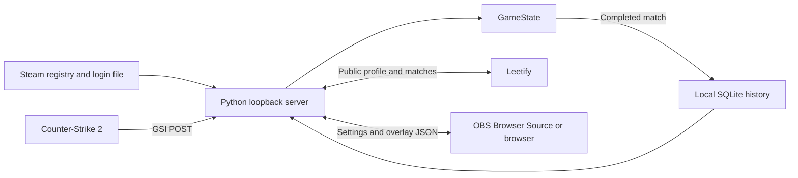

# Architecture

- `server.py` owns HTTP routing, the selected Steam account, settings and synchronization between the game receiver and the background worker. The worker checks for account changes, polls the provider when due and assembles snapshots for the UI.
- `gsi_state.py` prunes packets to supported fields, merges partial updates and tracks the map, local account, team and final result. Sample GSI is kept in a separate in-memory state. The browser discards expired live data.
- `match_history.py` writes each completed observation and enforces retention in one SQLite transaction. The primary key is a match observation UUID. Rows store SteamID64, completion time, map, mode, outcome, CT and T scores, and optional kills, deaths and assists. The account/time index supports the latest-20 query. SQLite stores local GSI data only.
- `providers.py` normalizes public Leetify payloads. `profile_sync.py` owns the interval, retry schedule and per-session rating comparison. Provider snapshots live in process memory.
- `web/` contains the vanilla JS overlay and Settings page. The Browser Source polls `/api/overlay` roughly every two seconds and renders with text nodes. OBS owns position and scale. Demo rendering uses built-in sample values.

For new GSI fields, extend the field list, update rendering and cover partial and missing packets in the test suite. Provider changes should preserve the normalized profile fields and account isolation. Add fictional fixtures for any additional response shapes. See the [HTTP API](API.md) and [contribution guide](../CONTRIBUTING.md).
