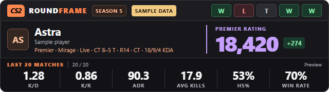

# Install Roundframe on Windows 10 or 11

You need [Python 3.10+](https://www.python.org/downloads/windows/), [OBS Studio](https://obsproject.com/download), and Steam with CS2 for live use. Install Python for your Windows user and enable the launcher or the PATH option. Open a new Command Prompt and try `py -3 --version` or `python --version`. The overlay does not require pip packages or administrator privileges when you can write to your CS2 install.

## Extract and configure CS2

1. From [Roundframe for CS2 Releases](https://github.com/abhiraj109/cs2-roundframe/releases/latest), download the Windows ZIP. For a local candidate, use the ZIP supplied by the maintainer. Right-click the ZIP and choose **Extract All**. Pick a permanent directory you can write to, such as a folder under Documents.
2. Open the extracted folder and double-click `setup_once.bat`. It uses Steam's registry entries and library list to locate CS2 and copies the GSI config. Answer **N** to launch manually or **Y** to add a Startup shortcut for this folder.
3. If automatic setup cannot find CS2, right-click CS2 in Steam and choose **Manage → Browse local files**. Copy `gsi/gamestate_integration_cs2_obs_overlay.cfg` from this project to `game\csgo\cfg\` in the opened CS2 folder. Confirm the destination filename ends in `.cfg`.
4. Start Steam, sign in, then run `run_overlay.bat`. Keep the command window open. Fully exit and restart CS2 after installing GSI.

To sync Premier Rating and provider match stats, use a public Leetify profile connected to the same Steam account. Open `http://127.0.0.1:3000/settings` to check detection or enter a SteamID64 override.

## Add the Browser Source

1. In OBS, select a scene. Under **Sources**, click **+ → Browser**, choose **Create new**, and give it a name.
2. Leave **Local file** off. Enter `http://127.0.0.1:3000/`. Set width to **640** and height to **180**. Keep default CSS and leave **Shutdown source when not visible** and **Refresh browser when scene becomes active** off for continuous updates.
3. Move the Browser Source above Game Capture in the source list. Right-click the Browser Source and choose **Transform → Reset Transform** if it was previously scaled or cropped. In **Edit Transform**, use top-left position alignment, zero crop and no bounding box.
4. Drag it to a place with room for the game HUD or enter a position such as the examples below. Apply any scaling in OBS, keeping the browser viewport at 640 × 180. [OBS Browser Source reference](https://obsproject.com/kb/browser-source)

| OBS base canvas | Uniform scale | Example position | Scene size |
| --- | ---: | --- | --- |
| 1920 × 1080 | 100% | 1248, 128 | 640 × 180 |
| 2560 × 1440 | 133⅓% | 1664, 171 | 853⅓ × 240 |
| 3840 × 2160 | 200% | 2496, 256 | 1280 × 360 |

Set the source URL to `http://127.0.0.1:3000/?demo=1` to see the full labeled demo before starting a match. To check sample GSI rendering, run `send_test_data.bat` and open `http://127.0.0.1:3000/?gsi-test=1` within 45 seconds. For live use restore the normal URL, join a match, and inspect `http://127.0.0.1:3000/api/health` for a recent GSI packet.

## Update, migrate or uninstall

1. Run `stop_overlay.bat` or press **Ctrl+C** in the server window. Back up `%LOCALAPPDATA%\CS2PremierOverlay` while the server is stopped.
2. Extract the new ZIP to a new folder. If upgrading from a pre-release build that wrote to its project folder, also stop that build. Copy its `settings.json` and `match_history.sqlite3` to `%LOCALAPPDATA%\CS2PremierOverlay`, creating the folder first. If that destination already contains either file, back up both versions and choose which one to keep. The app does not merge the files. If a stopped old install still has SQLite sidecar files, preserve the whole database set before migrating.
3. Run `setup_once.bat` again and reinstall the Startup shortcut if you use one. Restart CS2. The OBS URL and viewport stay the same. Keep the old copy until the new one starts and shows your expected settings.

To uninstall, stop the overlay, run `uninstall_gsi.bat` and `remove_startup.bat`, then delete the extracted folder. Keep or delete the Local AppData folder according to whether you want to retain settings and match history.
